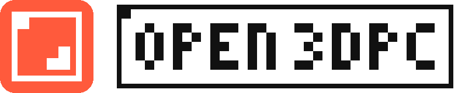
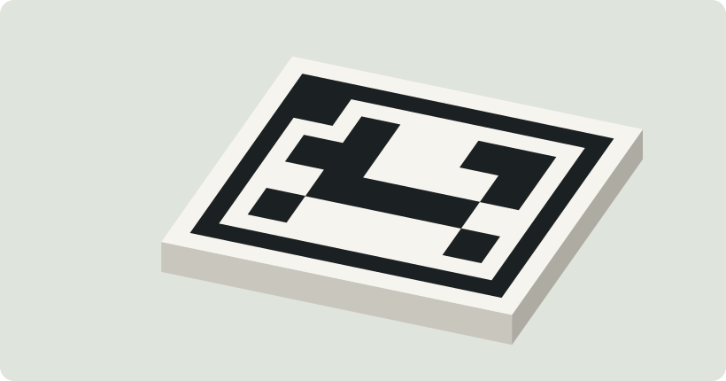
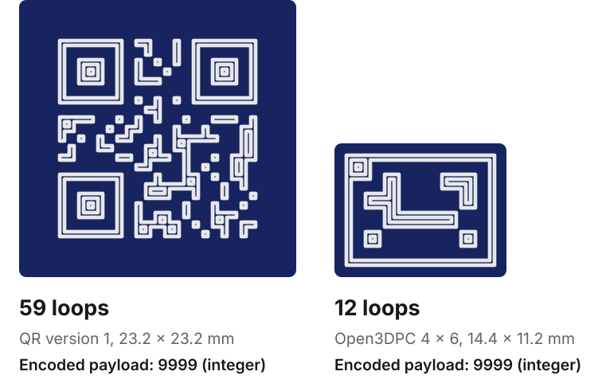
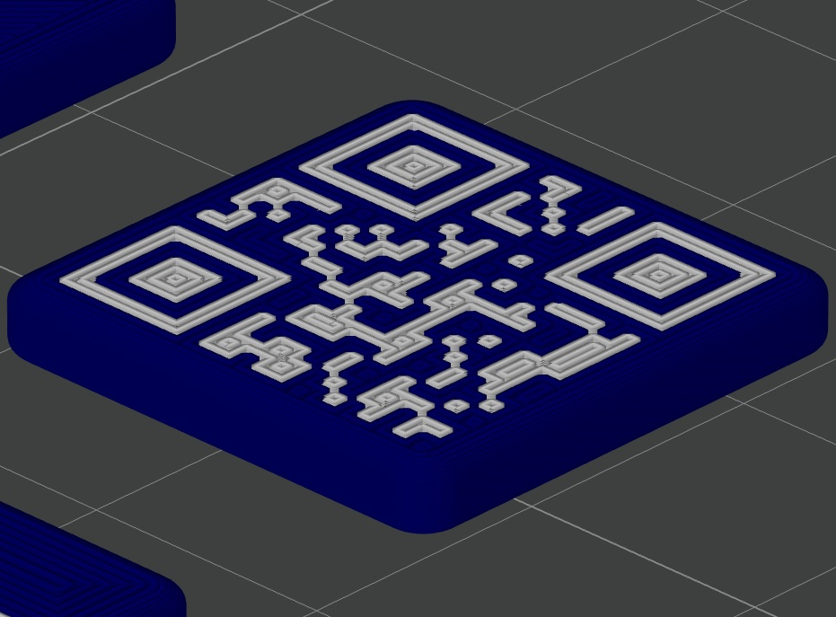
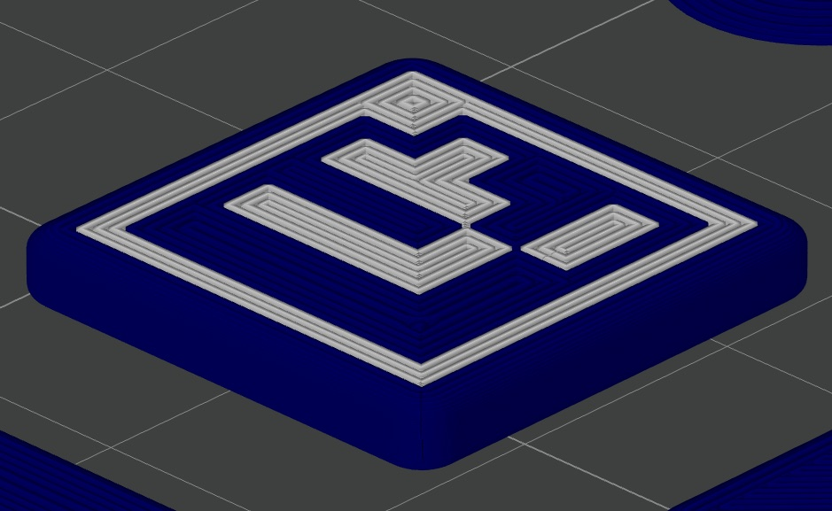
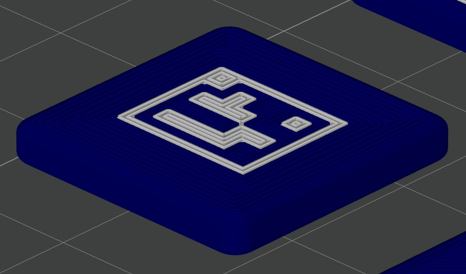
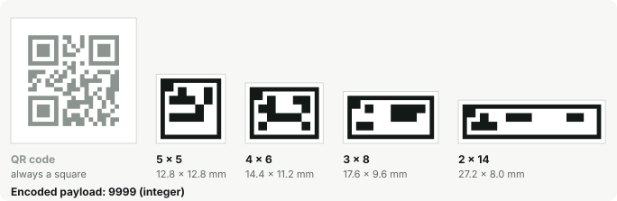

<h1 align="center"><a href="https://open3dpc.org"><picture>
<source media="(prefers-color-scheme: dark)" srcset="docs/img/lockup-dark.svg">

</picture></a></h1>

<p align="center"><b>A tiny two-color code made especially for 3D printing.</b><br>
Print a code into anything. Scan it with a phone.</p>

<p align="center">
<a href="https://open3dpc.org"><b>open3dpc.org</b></a> &nbsp;·&nbsp;
<a href="https://open3dpc.org/make">Make a code</a> &nbsp;·&nbsp;
<a href="https://open3dpc.org/scan">Scan one</a> &nbsp;·&nbsp;
<a href="#build-it-into-your-app">Build it in</a> &nbsp;·&nbsp;
<a href="spec/v2.md">Specification</a>
</p>

<p align="center"><a href="https://open3dpc.org"></a></p>

Open3DPC (Open 3D Print Code) is a compact binary code that is printed **as part of the object**, in two
filaments, on an ordinary FDM printer. No ink, no sticker, nothing to peel off. A phone camera reads it,
in the browser or in an app, and gets back a number. What the number opens is up to your app: a spool's
page, a drawer's contents, a game piece, a part's revision.

**Try it in a minute:** make a code on [open3dpc.org/make](https://open3dpc.org/make), then point your
phone at it on [open3dpc.org/scan](https://open3dpc.org/scan). Nothing to install, and pictures never
leave the phone.

## Why not a QR code?

QR and Data Matrix were designed for paper and ink. To help a weak scanner they carry fixed scaffolding
built from single, isolated squares, and for a 0.4 mm nozzle an isolated square at the printer's limit
is the hardest thing to make: the head travels, stops, starts and stops again, and that is where strings
and blobs come from.

Open3DPC makes the opposite trade. A phone has computation to spare, so the complexity lives in the
reader and the printed object stays easy to make:

- **The thinnest part is one continuous line.** Only the outer frame is as thin as two lines of the
  nozzle, and the printer lays it down in one closed loop.
- **Every square standing alone is twice as wide**, four times the area of a QR dot. Squares that touch
  merge into larger shapes.
- **One frame and one marked corner instead of targets.** No finder patterns, no timing dots.
- **A checksum instead of error correction.** Plastic does not crease, so no room is spent on torn paper.
  A damaged code is rejected, never guessed.
- **The size follows your printer.** Any number of rows and columns that hold your payload, at the module
  your nozzle prints cleanly.

### What the printer sees

Every closed line below is one loop of a 0.4 mm nozzle: it starts, goes round and stops, and every start
and stop is a chance for a blob or a string. Same number, same 0.8 mm thinnest feature, one scale:

<p align="center"></p>

The same in a slicer, on 20 × 20 mm tiles with a 0.8 mm thinnest feature, two lines of a 0.4 mm nozzle.
On the left the QR code, short loops around every single square; in the middle Open3DPC 5 × 5 stretched
to the same size, a few long loops; on the right Open3DPC 4 × 5 at the size it needs.

<p align="center">



</p>

Fewer, longer loops and no square at the printer's limit: the code comes out clean on an ordinary
printer, and it is what the phone needs to read it.

### Any shape the part allows

A QR code is always a square. Open3DPC takes any rows and columns that hold the number, so it fits where
a square does not: a rim, a handle, the edge of a lid. The same 9999, from square to long, at one scale:

<p align="center"></p>

Every shape that holds a number is in the gallery of the [generator](https://open3dpc.org/make). The flattest,
two rows, carry a checksum of only two bits: accept only the shapes you print, and prefer three rows when
the part has room.

### And it is smaller

<p align="center"></p>

| 9999, thinnest feature 0.8 mm | Size with quiet zone | Dark shapes | Single 0.8 mm dots |
|---|---:|---:|---:|
| QR version 1 | 23.2 × 23.2 mm | 39 | 15 |
| **Open3DPC 4 × 6** | **14.4 × 11.2 mm** | **5** | **0** |

The same number takes 3.3 times less area than the QR code. With the squares standing alone made equal,
the QR code takes 13.3 times the area. The comparison is drawn live, with the nozzle's path, on
[open3dpc.org](https://open3dpc.org/#why); the full argument, with Micro QR and Data Matrix, is in the
[concept](docs/concept.md#why-not-a-qr-code).

## How a code is made

<p align="center"></p>

A frame, half a module wide, around a grid of rows and columns. The square in one corner is joined to the
frame and tells the reader which way up the code is. Then come the payload bits, a terminator, zero
padding and a checksum of one to ten bits down the last column. The code holds bits and their count;
the format has no version, type or owner field ([specification](spec/v2.md)).

A phone finds the frame, straightens it, counts the rows and columns, turns the grid until the mark is in
its corner, and checks the checksum. It reads all four turns, dark on light or light on dark, and acts
only on a code seen in two frames ([how the readers work](docs/reader-pipeline.md)).

## Make a code

**On the web:** [open3dpc.org/make](https://open3dpc.org/make). Enter a number or bits, set your nozzle,
the thinnest line, the code height and the plate under it, pick a shape from the gallery, and download:

- **STL** of the dark code and of the light body, to load as one object with two filaments;
- **SVG** in millimetres, and **PNG**.

The same page is in [generator/](generator/) and runs offline: `cd generator && python3 -m http.server`.

**From JavaScript**, with no dependencies:

```js
import { encode, bitsFromInteger, stl, backingStl, svg } from './generator/open3dpc.js';

const code = encode(bitsFromInteger(4242, 14), 4, 6);   // 14 bits, 4 rows × 6 columns
stl(code, { materialHeight: 0.6 });                     // Uint8Array: the dark material
backingStl(code, { plate: 1 });                         // Uint8Array: the light body under it
svg(code, { quietZone: true });                         // exact, in millimetres
```

Print it in two filaments with strong contrast, and keep the quiet zone around the frame clear.

## Scan a code

**On a phone:** [open3dpc.org/scan](https://open3dpc.org/scan). Open it, allow the camera, point. It also
reads a photo. The page is [generator/scan/](generator/scan/), and its reader is the JavaScript library
below.

## Build it into your app

Three readers, one algorithm, no vision library of their own. Each finds its own rectangles; the Swift
reader also asks Apple's Vision.

| Platform | Library | Guide | Camera example |
|---|---|---|---|
| Web and Node | [`open3dpc-reader.js`](generator/open3dpc-reader.js) | [docs/web.md](docs/web.md) | [scan/scan.js](generator/scan/scan.js) |
| iOS 15+, macOS 12+ | [`Open3DPCKit`](swift/), Swift package | [docs/ios.md](docs/ios.md) | [Open3DPCScannerView.swift](examples/ios/Open3DPCScannerView.swift) |
| Android and the JVM | [Kotlin library](kotlin/), Java 11 | [docs/android.md](docs/android.md) | [Open3DPCCamera.kt](examples/android/Open3DPCCamera.kt) |

**Ask your agent.** Paste this into Claude Code, Cursor or Codex:

```text
Add an Open3DPC scanner to this app. Read https://github.com/Open3DPC/open3dpc/blob/main/docs/web.md,
use the reader it describes, accept only 14-bit codes, and call onCode(number) when one is confirmed.
```

**Or write it.** JavaScript:

```js
import { Frame, Open3DPCReader, Open3DPCStabilizer } from './open3dpc-reader.js';

const reader = new Open3DPCReader({ payloadLengths: [14] });
const stabilizer = new Open3DPCStabilizer();
const code = stabilizer.observe(reader.read(Frame.fromImageData(image)), performance.now());
if (code) console.log(code.value);                     // 4242n, once seen in two frames
```

Swift, with `https://github.com/Open3DPC/open3dpc` added as a package:

```swift
let reader = Open3DPCReader(options: .init(payloadLengths: [14]))
var stabilizer = Open3DPCStabilizer()
if let code = stabilizer.observe(reader.read(pixelBuffer, regionOfInterest: viewfinder)) {
    print(code.value!)                                  // 4242
}
```

Kotlin:

```kotlin
val reader = Open3DPCReader(payloadLengths = setOf(14))
val stabilizer = Open3DPCStabilizer()
stabilizer.observe(reader.read(frame, viewfinder), nowMs)?.let { println(it.value) }   // 4242
```

Accept only the lengths and shapes you print: fewer accepted codes means fewer false reads.

## Ideas

<p align="center"><a href="https://open3dpc.org/#ideas"></a></p>

Filament spools that know what is left on them, tool drawers that list their tools, board game pieces
that tell the app who they are, key tags that find their way home, moving boxes, printed parts that know
their revision. Each idea on [open3dpc.org](https://open3dpc.org/#ideas) comes with a prompt for your
agent.

## What is here

| Path | What |
|---|---|
| [spec/](spec/) | The specification, v2, with [test vectors](spec/vectors/v2.json) and [profiles](spec/profiles.md) |
| [docs/concept.md](docs/concept.md) | What Open3DPC is, why, and the comparison with QR, Micro QR and Data Matrix |
| [docs/reader-pipeline.md](docs/reader-pipeline.md) | How the readers work, stage by stage, and their known limits |
| [generator/](generator/) | The generator and the scanner pages, and the JavaScript under both |
| [swift/](swift/) | `Open3DPCKit`, the Swift package |
| [kotlin/](kotlin/) | The Kotlin library |
| [examples/](examples/) | Minimal camera scanners for iOS and Android |

## Status

The format is v2 and settled. It is used in the [Enforso](https://enforso.com) apps, where it marks
printed stickers; the Swift and Kotlin readers were extracted from them. Every part passes the test
vectors, and the generator's matrix, SVG and STL match, byte for byte, the generator it was ported from.

The libraries are young and not yet released to a package registry, and their API may change. The
readers refuse some codes on purpose and have [known limits](docs/reader-pipeline.md#known-limits-of-the-readers).
Reading distance and success rate across printers and phones are
[not yet published](docs/concept.md#what-has-not-been-measured). If you print and scan codes, please
[tell us how it went](CONTRIBUTING.md).

## Licence

Code and test vectors: [Apache 2.0](LICENSE). Specification, documentation and figures:
[CC BY 4.0](LICENSE-docs). Neither licence covers the name Open3DPC as a trade mark.
QR Code is a registered trademark of DENSO WAVE INCORPORATED.

Made by [Roman Simonov](https://romanaerl.github.io) from [Doinga](https://doinga.com) for [Enforso](https://enforso.com) and [Pilldone](https://pilldone.com),
and open-sourced for 3D printing enthusiasts everywhere.
