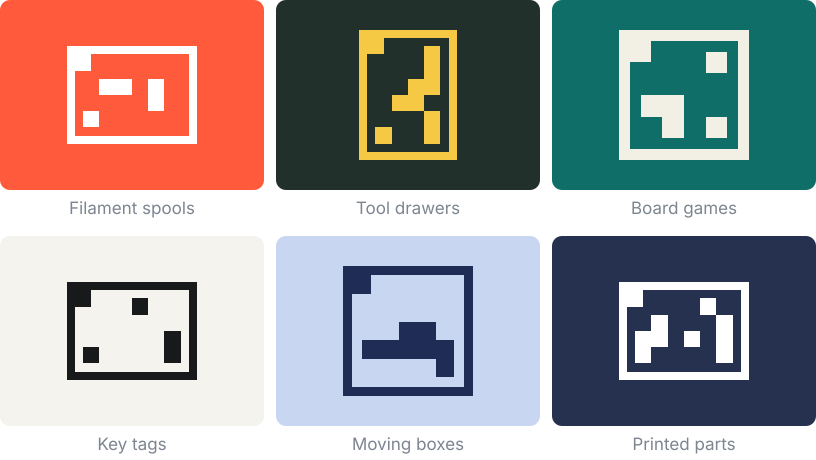

<h1 align="center"><picture>
<source media="(prefers-color-scheme: dark)" srcset="docs/img/lockup-dark.svg">

</picture></h1>

<p align="center"><b>A tiny two-color code made especially for 3D printing.</b><br>
Print a code into anything. Scan it with a phone.</p>

<p align="center"></p>

<h3 align="center"><a href="generator/">Make</a> &nbsp;·&nbsp; <a href="generator/scan/">Scan</a> &nbsp;·&nbsp; <a href="#build">Build</a></h3>

It is printed as part of the object: no ink, no sticker, and no dot as small as your printer's limit.
A phone reads it in the browser, with nothing to install. The code holds a number; what it opens is up
to your app.

<p align="center"></p>

## Build

### Ask your agent

```text
Add an Open3DPC scanner to this app. Read https://github.com/romanaerl/open3dpc/blob/main/docs/web.md,
use the reader it describes, accept only 14-bit codes, and call onCode(number) when one is confirmed.
```

### Or write it

Read a code ([guide](docs/web.md)), with no dependencies:

```js
import { Frame, Open3DPCReader } from './open3dpc-reader.js';

const reader = new Open3DPCReader({ payloadLengths: [14] });
reader.read(Frame.fromImageData(image))[0]?.value;   // 4242n
```

Make one, ready to slice in two filaments with strong contrast:

```js
import { encode, bitsFromInteger, stl } from './open3dpc.js';

stl(encode(bitsFromInteger(4242, 14), 4, 6));        // Uint8Array, the dark material
```

Also for [iOS](docs/ios.md) (Swift) and [Android](docs/android.md) (Kotlin). Neither needs a vision
library of its own.

## Learn more

| I want to | Go to |
|---|---|
| Understand why it is not a QR code | [Concept](docs/concept.md#why-not-a-qr-code) |
| Make codes on my own machine | [generator/](generator/): `cd generator && python3 -m http.server` |
| Write my own reader | [Specification](spec/v2.md) and [test vectors](spec/vectors/v2.json) |
| Know how the readers work, and where they fail | [Reader pipeline](docs/reader-pipeline.md#known-limits-of-the-readers) |
| Know what is not measured yet | [Limits](docs/concept.md#what-has-not-been-measured) |
| Help | [Contributing](CONTRIBUTING.md) |

## Status

The format is v2 and settled. It is used in the [Enforso](https://enforso.com) apps, where it marks
printed stickers; the Swift and Kotlin readers were extracted from them. The libraries are young and
unreleased, and their API may change. Every part passes the test vectors. Print accuracy, reading
distance and success rate on real prints are [not measured](docs/concept.md#what-has-not-been-measured).

Code and test vectors: [Apache 2.0](LICENSE). Specification, documentation and figures:
[CC BY 4.0](LICENSE-docs). Neither licence covers the name Open3DPC as a trade mark.
QR Code is a registered trademark of DENSO WAVE INCORPORATED.
