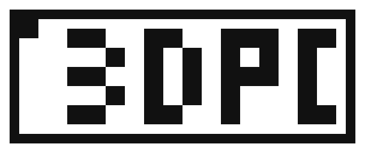

<p align="center"></p>

<p align="center"></p>

<h1 align="center">Open3DPC</h1>
<p align="center"><b>A code that prints as part of the object.</b><br>
An open two-colour code for FDM 3D printers, read by a phone camera.</p>

<p align="center">
<a href="docs/concept.md">Concept</a> ·
<a href="spec/v2.md">Specification</a> ·
<a href="generator/">Generator</a> ·
<a href="docs/ios.md">iOS</a> ·
<a href="docs/android.md">Android</a> ·
<a href="CONTRIBUTING.md">Contributing</a>
</p>

---

QR and Data Matrix were designed for paper and ink. On an FDM printer their small stand-alone squares
are the hardest thing to make. Open3DPC (Open 3D Print Code) has none at the printer's limit: its
thinnest part is a continuous frame, and the smallest stand-alone element is twice as wide.

<p align="center"></p>

| The number 9999, thinnest feature 0.8 mm | Size with quiet zone | Dark shapes | Single 0.8 mm dots |
|---|---:|---:|---:|
| Data Matrix 10 × 10 | 9.6 × 9.6 mm | 9 | 7 |
| Micro QR M1 | 12 × 12 mm | 11 | 2 |
| **Open3DPC 4 × 6** | **14.4 × 11.2 mm** | **5** | **0** |
| QR version 1 | 23.2 × 23.2 mm | 39 | 15 |

It is not the smallest code; it is the one with no single dots. When the stand-alone elements are made
equal, the QR code takes 13.3 times the area, Micro QR 3.6 and Data Matrix 2.3.
[The whole comparison](docs/concept.md#why-not-a-qr-code).

- **Small and scalable.** Any number of bits, any rectangle that holds them. The module follows your nozzle.
- **Detects, does not guess.** A checksum of one to ten bits and no error correction: a damaged code is
  rejected.
- **Any way up.** Four rotations, dark on light or light on dark.
- **Yours.** The code holds bits and their count. What they mean is up to your application.

## Make a code

Open the [generator](generator/) (a static page, everything runs in the browser; to run it from a clone:
`cd generator && python3 -m http.server`). Enter a number, choose a shape, download the STL.
Print it in two filaments with strong contrast and keep the quiet zone clear.

From JavaScript, with no dependencies:

```js
import { encode, bitsFromInteger, svg, stl } from './generator/open3dpc.js';

const code = encode(bitsFromInteger(9999, 14), 4, 6);   // 4 rows × 6 columns
code.rows;                                              // [ 'O10011', '110001', '011110', '100001' ]
svg(code);                                              // exact, in millimetres
stl(code, { materialHeight: 0.6 });                     // Uint8Array, the dark material
```

## Read a code

Swift, iOS 15 and later ([guide](docs/ios.md), [camera example](examples/ios/Open3DPCScannerView.swift)):

```swift
let reader = Open3DPCReader(options: .init(payloadLengths: [14]))
var stabilizer = Open3DPCStabilizer()
if let code = stabilizer.observe(reader.read(pixelBuffer, regionOfInterest: viewfinder)) {
    print(code.value!)                                  // 9999
}
```

Kotlin, Android and JVM ([guide](docs/android.md), [camera example](examples/android/Open3DPCCamera.kt)):

```kotlin
val reader = Open3DPCReader(payloadLengths = setOf(14))
val stabilizer = Open3DPCStabilizer()
stabilizer.observe(reader.read(frame, viewfinder), nowMs)?.let { println(it.value) }   // 9999
```

Neither needs a vision library of its own: the Swift reader uses Apple's Vision, the Kotlin one finds
its own rectangles.

## What is here

| Path | What |
|---|---|
| [docs/concept.md](docs/concept.md) | What Open3DPC is, why, and the comparison with QR, Micro QR and Data Matrix |
| [spec/](spec/) | The specification, v2, with [test vectors](spec/vectors/v2.json) |
| [generator/](generator/) | The generator page and the encoder it is built on |
| [swift/](swift/) | `Open3DPCKit`, the Swift package ([guide](docs/ios.md)) |
| [kotlin/](kotlin/) | The Kotlin library ([guide](docs/android.md)) |
| [examples/](examples/) | Minimal camera scanners for both |
| [docs/reader-pipeline.md](docs/reader-pipeline.md) | How the readers work, stage by stage, and their limits |

## Status

The format is v2 and settled. It comes from the [Enforso](https://enforso.com) apps, where it marks pill
boxes and stickers; the readers here were extracted from them. The libraries are young and unreleased,
and their API may change.

Every part passes the test vectors. The generator's matrix, SVG and STL are byte for byte those of the
PHP generator it was ported from, apart from a label, a rendering hint and the STL header. Both readers
decode pictures the generator draws, with [known refusals](docs/reader-pipeline.md#known-limits-of-the-readers).

**Not measured:** print accuracy, reading distance and success rate on real prints and phones, and
whether the minimum quiet zone is enough everywhere ([details](docs/concept.md#what-has-not-been-measured)).

## Licence

Code and test vectors: [Apache 2.0](LICENSE). Specification, documentation and figures:
[CC BY 4.0](LICENSE-docs). Neither licence covers the name Open3DPC as a trade mark.
