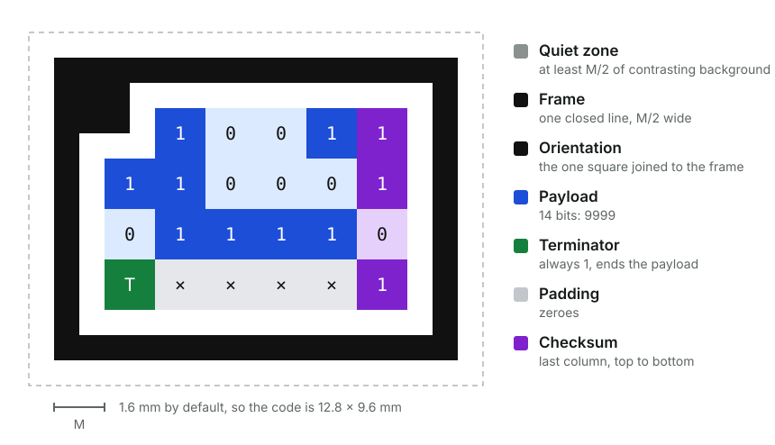
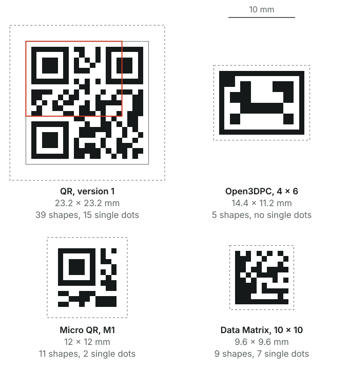
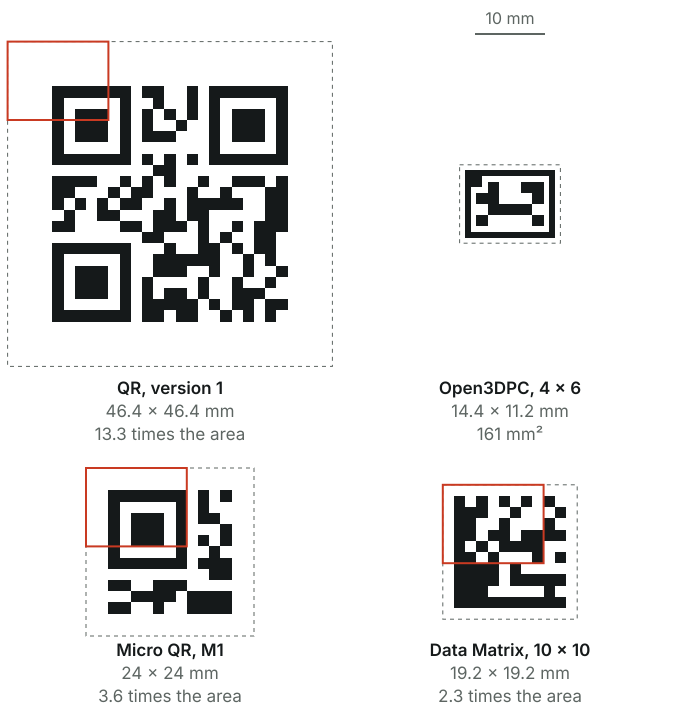

# Open3DPC: a code that prints as part of the object

Open3DPC (Open 3D Print Code) is a small two-color binary code made to be printed
into an object on a two-color or multicolor FDM 3D printer, rather than stuck on
as a label. Two colors are what make the code readable: it needs contrast. The
simplest setup is a printer that switches filament automatically; a color change
between layers also works, but takes more care.

It was made for the [Enforso](https://enforso.com) apps, which use it on numbered
printed stickers. Nothing in the format is specific to that use.

## Why not a QR code

QR and Data Matrix were designed for paper, ink and cheap scanners. To help a weak
decoder they carry fixed scaffolding: timing tracks and alignment marks built from
single, isolated squares. For a printer with a 0.4 mm nozzle, an isolated 0.8 mm
square is the hardest thing to make: the head has to travel, retract, start and
stop, and that is where stringing and blobs come from. Those squares are there
whatever the data, so the hardest dot sets the size of the whole code.

Open3DPC makes the opposite trade. A modern phone has computation to spare, so
complexity moves into the decoder and the printed object stays as easy to make as
possible.

Open3DPC has no isolated features at the minimum size. Its thinnest parts are
continuous lines, the outer frame and the gap just inside it, each half a module
wide. The smallest isolated element is a whole cell, twice as wide as the thinnest
line, and cells that touch merge into larger shapes, which print more cleanly. So
the size of the code comes down to one question: how wide must the thinnest line be
to print well?

With a standard 0.4 mm nozzle, a line two passes wide is 0.8 mm; four passes make
1.6 mm. A 0.8 mm half-module gives a 1.6 mm module. Take the number 9999, which
needs 14 bits. Open3DPC holds it in four rows of six cells (`4 × 6`; rows always
come first). With the frame the code is 8 modules wide and 6 high, 12.8 × 9.6 mm,
and with a quiet zone of half a module around it, 14.4 × 11.2 mm.

The smallest QR code, version 1, is 21 × 21 modules whatever it holds. Its smallest
feature is a whole module, so at the same 0.8 mm it is 16.8 mm square: 18.4 mm with
a one-module margin, 23.2 mm with the four-module quiet zone the standard asks for.
Most of its modules are finder, timing and format patterns, and even at the lowest
level 7 of its 26 codewords are error correction: insurance against torn paper.

*All four codes hold the number 9999 and are drawn at the same scale, with a 0.8 mm
thinnest feature. Sizes include the quiet zone (dashed); the thin line around the QR
code is a one-module margin, 18.4 mm. A single dot is one isolated 0.8 mm square;
squares that touch only at a corner count as separate. The red outline is the
Open3DPC footprint, quiet zone included, laid over the QR code.*

| 9999 at a 0.8 mm thinnest feature | Size with quiet zone | Dark shapes | Single 0.8 mm dots |
|---|---:|---:|---:|
| Data Matrix 10 × 10 | 9.6 × 9.6 mm | 9 | 7 |
| Micro QR M1 | 12 × 12 mm | 11 | 2 |
| **Open3DPC 4 × 6** | **14.4 × 11.2 mm** | **5** | **0** |
| QR version 1 | 23.2 × 23.2 mm | 39 | 15 |

Smaller codes exist. For the same number a Micro QR code takes 12 × 12 mm and a Data
Matrix 9.6 × 9.6 mm, both less than Open3DPC. But they still rely on isolated dots:
7 of the 9 shapes in this Data Matrix are single 0.8 mm squares. Open3DPC is not the
smallest code here; it is the one with no isolated dots at the printer's limit.

Quiet zones included, the QR code takes 2.1 times the area with a one-module margin
and 3.3 times with the standard quiet zone. It is also busier: 39 separate dark
shapes, 15 of them single 0.8 mm dots right at the printer's limit, against 5 shapes
in Open3DPC, none smaller than 1.6 mm. With four passes per line every size doubles,
and the ratios stay the same.

### With the stand-alone elements equal

So far the comparison has been generous to the other codes. It gives every code the
same thinnest feature, but that feature is not the same thing in each. In Open3DPC it
is continuous: the frame is a closed line that the printer lays down all the way round.
In the other codes it is also a single dot, and stand-alone elements are the real
problem in printing.

Compare those instead. Open3DPC takes less than a third of the space of the standard
QR code in the figure above, yet its stand-alone elements are twice as wide, four
times the area.

Now make the stand-alone elements equal: a QR code with the same 1.6 mm module as
Open3DPC. It is 33.6 mm across, 46.4 mm with its quiet zone: 2153 mm² against
161 mm², or 13.3 times the area. Even with a one-module margin, at 36.8 mm, it is
8.4 times. Micro QR and Data Matrix, which were smaller before, are now larger too:
3.6 and 2.3 times.

*The same four codes, each still holding 9999, redrawn so that the smallest
stand-alone element is 1.6 mm in all of them. One scale, smaller than in the figure
above. Sizes include the quiet zone (dashed); the red outline is the Open3DPC
footprint, quiet zone included.*

## Detection, not correction

Each code carries a checksum and no error correction. Error correction pays for
scratches, smudges and torn paper; rigid plastic is far less exposed to those, and on
a small part every millimetre counts. A damaged code is rejected, never guessed.

The checksum grows with the number of rows, up to ten bits, so a flatter code is a
weaker one:

| 9 bits in | Checksum | Random data and checksum bits that pass the checksum |
|---|---:|---:|
| `2 × 7` | 2 bits | 25 % |
| `3 × 5` | 3 bits | 12.5 % |
| `4 × 4` | 4 bits | 6.25 % |

Space you do not use works as detection too. What decides a false read is the number
of valid values over the number of possible patterns, so an application that accepts
few values, or one payload length, or one shape, reads a wrong code less often. The
readers in this repository let you fix the lengths and the shapes you accept.

## What a code holds

Only bits, and how many there are. The count decides the meaning: a nine-bit code and
a fourteen-bit code are different things, and an application lists the lengths it
understands ([profiles](../spec/profiles.md)). The format itself has no version, type
or owner field: Open3DPC is the container, not its contents. A scanner is told, for each session, which
lengths and shapes it accepts, and ignores the rest.

## How the phone reads it

1. It looks for rectangles in the viewfinder and keeps those with exactly one heavy
   corner: the orientation mark.
2. It straightens the image, finds the frame and counts rows and columns.
3. It turns the grid until the mark is top left, so any of four rotations works, dark
   on light or light on dark.
4. It checks the checksum. The checksum never moves the grid to find a pass.
5. It acts only when the same code is seen in two frames. With two codes in view it
   reports nothing until there is one.

The same steps in detail: [reader-pipeline.md](reader-pipeline.md).

## Known limits

- The two materials need strong contrast. Pairs that look different to the eye but
  are close in tone, such as white on pink, may not read.
- A code needs its quiet zone: at least half a module of contrasting background on
  every side. A light code on a light body can merge with it.
- There is no error correction, and detection is weak on the flattest shapes.
- A checksum cannot notice that the camera read the code *next to* the one you meant.
  Give the person a clear viewfinder and confirm what was read.

## What has not been measured

The comparison above is arithmetic on the code geometries. These are **not measured**
yet, and nothing here should be read as a promise about them:

- how accurately a given printer, nozzle and filament reproduces the code, and how
  often prints of each symbology fail;
- reading distance, reading time and success rate on particular phones and in
  particular light;
- whether the minimum quiet zone of `M/2` is enough on every material and background;
- wear: how a printed code reads after months of use.

If you measure any of it, please [tell us](../CONTRIBUTING.md).
